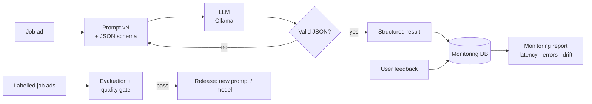

# LLMOps: Job-Ad Extractor

**An LLM application taken through the full LLMOps cycle (build, manage, deploy and monitor), with versioned prompts, automated evaluation, a quality gate, a REST API, Docker, CI and monitoring.**

The task: read a German or English job ad and return clean, structured data, the kind of data a job platform or recruiting team needs to filter thousands of ads.

```text
"Junior Data Analyst (m/w/d) – Standort: Hamburg … Power BI, SQL … Deutsch B2 … Hybrid … 46.000 – 52.000 €"
```
```json
{"job_title": "Junior Data Analyst", "seniority": "junior", "skills": ["power bi", "sql"],
 "german_level": "B2", "english_required": true, "work_mode": "hybrid",
 "salary_min": 46000, "salary_max": 52000, "location": "Hamburg"}
```

It runs on a free, open-source model (Llama 3.2 via [Ollama](https://ollama.com)) on a normal laptop. No paid API key.

---

## The LLMOps cycle in this project



| Stage | What it means | Where in the code |
|---|---|---|
| **Build** | Prompt templates, a strict output schema, retry on invalid answers, unit tests | `prompts/`, `jobad_llmops/schema.py`, `extractor.py`, `tests/` |
| **Manage** | Prompts are versioned files (`v1`, `v2`), model and prompt are chosen in `config.yaml`, every run is scored on labelled data and logged to a leaderboard | `config.yaml`, `eval/evaluate.py`, `eval/results/leaderboard.csv` |
| **Deploy** | FastAPI service, Docker image, docker-compose with the LLM, CI that runs tests and the quality gate on every push | `jobad_llmops/api.py`, `Dockerfile`, `docker-compose.yml`, `.github/workflows/` |
| **Monitor** | Every request is logged: valid-JSON rate, latency p50/p95, user corrections per field, input drift (language mix and ad length vs the evaluation data) | `jobad_llmops/monitoring.py`, `scripts/monitoring_report.py` |

## Evaluation

Two labelled test sets (both synthetic, written for this project in the style of real ads; company names are invented):

- **Development set:** 30 ads, used while writing prompts and rules.
- **Held-out set:** 12 ads written afterwards in different wording, and never used for tuning. This is the honest test.

Each run reports field accuracy (8 fields), skill precision/recall/F1, valid-JSON rate and latency. `config.yaml` defines a **quality gate**: a run below the minimum fails, so a worse prompt or model cannot be released by accident.

### Results

| Approach | Set | Field accuracy | Skills F1 | Valid JSON | Latency p50 |
|---|---|---:|---:|---:|---:|
| Rule-based baseline (no LLM) | development | 92.5 % | 0.99 | 100 % | < 1 ms |
| Rule-based baseline (no LLM) | **held-out** | **68.8 %** | 0.91 | 100 % | < 1 ms |
| LLM (Llama 3.2 3B, prompt v2) | development | 86.7 % | 0.89 | 100 % | 10.4 s |
| LLM (Llama 3.2 3B, prompt v2) | **held-out** | **80.2 %** | 0.89 | 100 % | 10.5 s |

LLM numbers are from the [LLM evaluation run](https://github.com/Sachinisand/LLMOps-Job-Ad-Extractor/actions/runs/38144055401) on a CPU-only GitHub runner. Both LLM runs pass the quality gate (valid JSON ≥ 95 %, field accuracy ≥ 75 %, skills F1 ≥ 0.70).

Accuracy by field on the held-out set:

| Field | Baseline | LLM |
|---|---:|---:|
| job_title | 100 % | 100 % |
| seniority | 50 % | 83 % |
| german_level | 75 % | 83 % |
| english_required | 92 % | 75 % |
| work_mode | 50 % | 83 % |
| salary_min | 83 % | 58 % |
| salary_max | 100 % | 58 % |
| location | 0 % | 100 % |

**What the results show**

- **The rules overfit.** They look best on the ads they were written for (92.5 %) but drop to 68.8 % on unseen wording; location falls to 0 %.
- **The LLM generalises better.** It loses only 6.5 points between the two sets and beats the rules on the held-out set by 11 points, mainly on location, seniority and work mode.
- **The LLM is weak on numbers.** Salary fields are its main error source (58 % on held-out). The prompt asks the model to turn monthly pay into yearly and to handle ranges and hourly pay, and a 3B model does that arithmetic unreliably. A next step would be to let the LLM copy the raw salary text and do the conversion in Python.
- **The cost is speed.** About 10 s per ad on CPU, against under 1 ms for the rules. Fine for a batch job, too slow for an interactive tool without a GPU or a smaller model.
- **Practical choice:** combine both. Use the LLM for text fields and rules for salaries, and compare the hybrid with the same evaluation.

To reproduce: Actions tab → *LLM evaluation* → *Run workflow* (installs Ollama on the runner, about 10 minutes), or run it locally (see below).

## Monitoring

`scripts/monitoring_report.py` turns the request log into a one-page report.
[Example report (demo data)](https://htmlpreview.github.io/?https://github.com/Sachinisand/LLMOps-Job-Ad-Extractor/blob/main/outputs/example_monitoring_report.html): a burst of English-only traffic triggers the **drift alert**, because the evaluation data is half German and the model has not been tested for that mix.

| Signal | Why it matters |
|---|---|
| Valid-JSON rate and retries | the model stops following the format (for example after a model update) |
| Latency p50 / p95 | users wait too long, or hardware is too small |
| User corrections per field | shows which field is wrong in real use; becomes new test data |
| Input drift | real ads differ from the tested ads, so the evaluation scores no longer apply |

## How to run (Windows, macOS or Linux)

```bash
python -m venv venv
venv\Scripts\activate                 # macOS/Linux: source venv/bin/activate
pip install -r requirements.txt

pytest -q                                             # 21 tests, no LLM needed
python -m eval.evaluate --backend baseline            # rule-based baseline
python -m eval.evaluate --backend baseline --set holdout
```

With the real LLM (install [Ollama](https://ollama.com/download) first):

```bash
ollama pull llama3.2:3b
python -m eval.evaluate --backend ollama --prompt v2
python -m eval.evaluate --backend ollama --prompt v2 --set holdout
python -m eval.evaluate --backend ollama --prompt v1 --set holdout   # compare prompt versions

uvicorn jobad_llmops.api:app --reload                 # API docs at http://localhost:8000/docs
python scripts/simulate_traffic.py --requests 40       # send test traffic through the model
python scripts/monitoring_report.py                    # -> outputs/monitoring_report.html
```

Or everything in Docker: `docker compose up -d`, then `docker compose exec ollama ollama pull llama3.2:3b`.

### API

| Method | Path | Purpose |
|---|---|---|
| GET | `/health` | running model and prompt version |
| POST | `/extract` | `{"text": "<job ad>"}` → structured result + `request_id` |
| POST | `/feedback` | `{"request_id": 1, "field": "seniority", "correct_value": "junior"}` |
| GET | `/metrics` | monitoring summary incl. drift |

## Design decisions

- **Structured output + schema validation.** The JSON schema is sent to Ollama and every answer is validated with Pydantic. Invalid answers are retried once, then reported as errors instead of passing bad data on.
- **Temperature 0.** The same ad gives the same answer, so evaluations are repeatable.
- **Baseline first.** A model is only worth running if it beats a simple, fast alternative on unseen data.
- **Prompts are code.** Each prompt version is a file under version control and is compared on the same test sets.
- **CI without an LLM.** Tests use the rule-based backend and fake LLM answers, so every push is checked in seconds. The real-model evaluation is a separate manual workflow.

## Limitations

- The test sets are small (42 ads) and synthetic. A production system would label a few hundred real ads.
- Language detection for drift uses a simple word list.
- Salary handling covers yearly and monthly pay; hourly pay is left empty on purpose.

## Project structure

```
LLMOps-Job-Ad-Extractor/
├── jobad_llmops/
│   ├── schema.py        ← output fields, allowed values, skill normalisation
│   ├── llm.py           ← Ollama backend + rule-based baseline
│   ├── extractor.py     ← prompt → model → validate → retry
│   ├── metrics.py       ← field accuracy, skill F1, quality gate
│   ├── monitoring.py    ← request log, feedback, latency, drift
│   └── api.py           ← FastAPI service
├── prompts/             ← v1.md, v2.md (versioned prompts)
├── eval/                ← labelled ads, evaluate.py, results/
├── scripts/             ← traffic simulation, monitoring report, test-set builders
├── tests/               ← 21 unit and API tests
├── outputs/             ← example monitoring report
├── config.yaml          ← model, prompt version, quality gate
├── Dockerfile, docker-compose.yml
└── .github/workflows/   ← CI + LLM evaluation
```

## Author

Sachini Hewahattage · [LinkedIn](https://www.linkedin.com/in/sachini-hewahattage) · [GitHub](https://github.com/Sachinisand)
